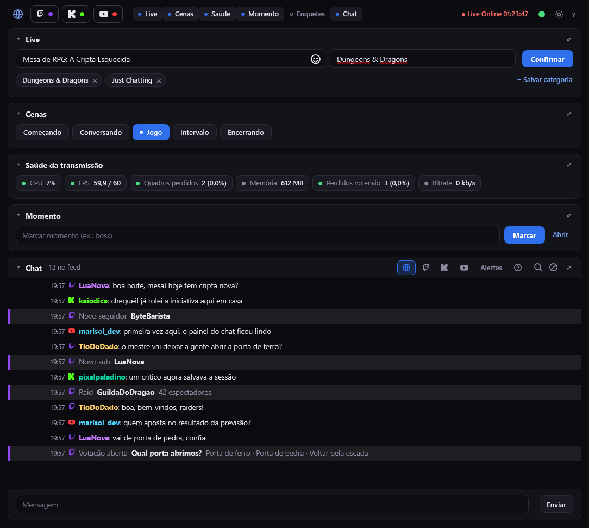
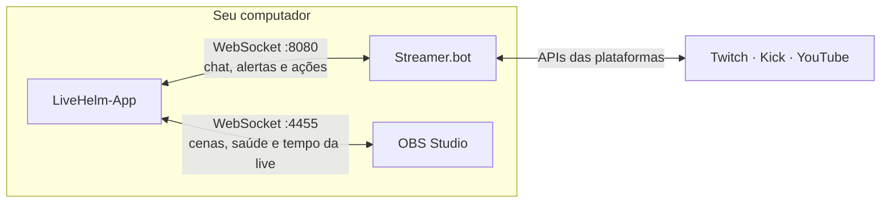
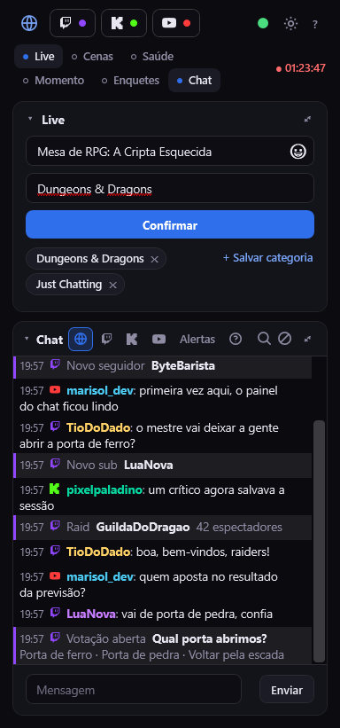
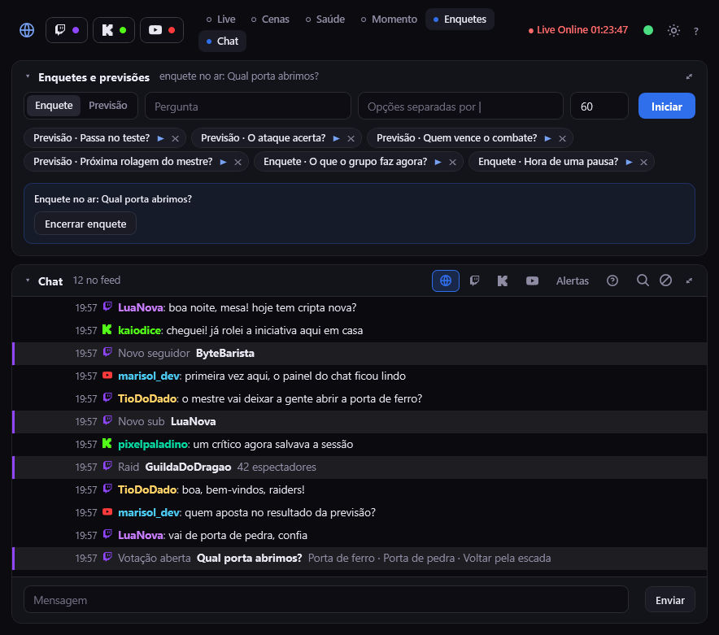

<p align="center">
  
</p>

# LiveHelm-App

> **Estado inicial de desenvolvimento.** O LiveHelm-App é novo: pode ter bugs, mudar sem aviso e ainda não tem testes
> automatizados. Ele pode banir pessoas e encerrar a live pelo OBS (essa parte vem desligada), então teste com calma antes de usá-lo
> numa transmissão importante. Relatos de problemas e sugestões são bem-vindos.

**O painel de controle da sua live, numa janela do Windows.**

Título e categoria nas três plataformas, cenas do OBS, saúde da transmissão, marcação de momentos, enquetes e previsões, e um chat
unificado de **Twitch, Kick e YouTube** com moderação. É a versão desktop do [LiveHelm](https://github.com/GustavoBoschi/livehelm)
(o dock do OBS): as duas falam com o mesmo **Streamer.bot** e usam as mesmas ações, então a configuração é compartilhada.

Não é overlay e não vai na transmissão. Ele conversa com o [Streamer.bot](https://streamer.bot), que fala com as plataformas, e com
o **OBS**, pelos servidores WebSocket dos dois. Tudo roda no seu computador.

> **Instalou e quer só configurar?** Vá direto para as [**Instruções**](docs/INSTRUCOES.md), com o passo a passo do Streamer.bot,
> do OBS e do programa.

## Sumário

- [Destaques](#destaques)
- [LiveHelm (dock) ou LiveHelm-App?](#livehelm-dock-ou-livehelm-app)
- [Como funciona](#como-funciona)
- [Começando](#começando)
- [Recursos](#recursos)
- [O que cada plataforma suporta](#o-que-cada-plataforma-suporta)
- [Configuração](#configuração)
- [Privacidade e segurança](#privacidade-e-segurança)
- [Limites conhecidos](#limites-conhecidos)
- [Desenvolvimento](#desenvolvimento)
- [Contribuindo](#contribuindo)
- [Licença e créditos](#licença-e-créditos)

## Destaques

- **Uma janela só** para o que você mexe durante a live: título, categoria, cenas, saúde, momentos, enquetes e chat.
- **Três plataformas juntas:** Twitch, Kick e YouTube. Ligue ou desligue cada uma no alto; o que você faz vale só para as ligadas.
- **Confirmação de verdade:** depois de mudar título e categoria, o painel espera a plataforma avisar e mostra o que ela
  realmente aplicou (amarelo quando ficou diferente do digitado).
- **Controle do OBS:** troca de cena com um clique e saúde da transmissão (CPU, FPS, quadros perdidos, bitrate) com cores de alerta.
- **Chat com moderação:** apagar, silenciar e banir com um clique, desfazer punições, busca, fila de perguntas, mensagens fixadas e
  alertas no mesmo feed, com emotes da Twitch, da Kick e de terceiros (7TV, BetterTTV, FrankerFaceZ).
- **Fica à mão:** bandeja do sistema, atalho global `Ctrl+Alt+P`, "sempre no topo" e layout que cabe numa janela estreita ao lado do
  preview do OBS.
- **Sem instalador:** é uma pasta com o programa; abra o `.exe`. Usa o .NET Framework 4.8, que já vem no Windows 10 e 11.
- **Gratuito**, com código disponível e documentação para quem quiser usar, estudar e adaptar.

## LiveHelm (dock) ou LiveHelm-App?

São dois jeitos de usar o mesmo sistema (as mesmas ações no Streamer.bot). Dá para usar os dois ao mesmo tempo.

| | **LiveHelm** (dock do OBS) | **LiveHelm-App** |
|---|---|---|
| Onde fica | Dentro do OBS, como dock de navegador | Janela própria do Windows |
| Instalação | Instalador que registra o dock no OBS | Pasta com o programa; abrir o `.exe` |
| Título e categoria | Sim | Sim |
| Tags da Twitch | Sim | Ainda não |
| Marcar momentos | Sim (a ação do Streamer.bot grava o arquivo) | Sim (o próprio programa grava o arquivo) |
| Enquetes e previsões | Sim | Sim |
| Chat com moderação | Sim | Sim, com emotes de terceiros, fila de perguntas e corretor ortográfico |
| Cenas e saúde do OBS | Não | Sim |
| Iniciar e encerrar live e gravação | Não | Sim (desligado por padrão) |
| Bandeja e atalho global | Não | Sim |
| Sistema | Qualquer OBS (o instalador é só Windows) | Windows |

## Como funciona



1. **O programa** é a interface. Ele guarda suas preferências (painéis, tema, posição da janela, atalhos) num arquivo de configuração
   no seu perfil do Windows.
2. **O Streamer.bot** é a ponte com as plataformas. O programa se conecta ao servidor WebSocket dele e **recebe** os eventos
   (mensagens, seguidores, inscrições, raids, enquetes...) e **pede** coisas executando *ações* (mudar o título, banir, enviar
   mensagem...). Essas ações são criadas uma vez no Streamer.bot, com nomes fixos (`Painel: Twitch`, `Painel: Chat`...), e a de chat usa
   um código C# que o próprio programa mostra e copia para você (botão `?`).
3. **O OBS** é controlado pelo servidor WebSocket dele: lista de cenas, troca de cena, estatísticas, tempo da live e da gravação.

## Começando

Você precisa de **Windows 10 ou 11**, do **Streamer.bot** (testado na versão 1.0.7) e, para as cenas e a saúde, do **OBS Studio 28
ou mais novo**.

1. **Streamer.bot:** entre com a conta de cada plataforma e ligue o servidor WebSocket (`Servers/Clients > WebSocket Server`).
2. **Ações:** crie no Streamer.bot as ações `Painel: Twitch`, `Painel: Kick`, `Painel: YouTube` e `Painel: Chat`, com o nome **EXATAMENTE igual** ao das Instruções (a de chat é só colar
   o código que o botão `?` do programa copia).
3. **OBS:** ligue o servidor WebSocket (`Ferramentas > Configurações do servidor WebSocket`).
4. **Programa:** baixe o `.zip` na página de *Releases*, extraia numa pasta e abra o `LiveHelm-App.exe`. Na engrenagem, confira os endereços e coloque as senhas, se houver.
5. **Conferir:** a bolinha de conexões no canto de cima fica verde quando tudo está conectado.

O passo a passo completo, com onde achar cada coisa em cada programa, está nas [**Instruções**](docs/INSTRUCOES.md).

## Recursos

### Barra de cima

Da esquerda para a direita:

- As **plataformas ativas** (Twitch, Kick e YouTube); o globo liga ou desliga todas de uma vez. Elas valem para tudo: atualizar a
  live, enviar mensagem, comandos e enquetes.
- As **chaves dos painéis** (Live, Cenas, Saúde, Momento, Enquetes e Chat): cada uma mostra ou esconde o painel inteiro.
- À direita: o **tempo ao vivo** (o OBS diz se a live está no ar), a **bolinha de conexões**, a **engrenagem** das configurações e o
  **`?`**, que mostra como criar as ações do Streamer.bot.

Os painéis recolhem até o título com um clique no cabeçalho, e o botão de foco de cada um recolhe os outros: o chat em foco ocupa a
janela toda, e Live, Cenas ou Enquetes em foco aparecem ampliados. Saúde e Momento vêm desligados na barra de cima.

**Janela estreita:** dá para encolher o programa até uns 360 px de largura, por exemplo para caber na coluna ao lado do preview do OBS.
Abaixo de 760 px o layout empilha, e a opção "Manter acima das outras janelas" deixa o painel sempre visível.

<p align="center">
  
</p>

### Conexões

Uma bolinha: **verde** (tudo conectado), **amarela** (falta alguma plataforma ou o OBS) e **vermelha** (sem Streamer.bot). Passe o mouse
para ver o estado do Streamer.bot, da Twitch, da Kick, do YouTube e do OBS; "Live Offline" ou "Live Online" diz se o OBS está
transmitindo. "Mostrar sempre na barra" deixa todos à vista.

### Live: título e categoria

Um campo de título, um de categoria e o botão **Confirmar**, que atualiza todas as plataformas ligadas ao mesmo tempo.

- O resultado aparece **por plataforma**: verde quando a plataforma confirmou, e amarelo quando o título ou a categoria ficou diferente
  do digitado ou não houve confirmação (por exemplo, uma categoria que não existe).
- As categorias que as plataformas já confirmaram e os atalhos que você salvou aparecem como sugestões enquanto você digita. Os
  atalhos são só categorias.
- Título, categoria e chat têm corretor ortográfico (clique direito na palavra sublinhada). O título aceita emojis: o botão no campo
  abre o seletor do Windows (também `Win` + `.`).

### Cenas

Lista as cenas do OBS em botões pequenos, destaca a cena no ar e troca de cena ao clicar.

### Saúde da transmissão

CPU, FPS (real e a meta do OBS), quadros perdidos no render, memória e, com a live no ar, quadros perdidos no envio e bitrate. Verde,
amarelo e vermelho avisam quando passa do normal; quadros perdidos ficam amarelos enquanto o número sobe. O painel só consulta o OBS
enquanto está ligado, a cada 2 s com a janela à vista (parado se ela está escondida).

Aqui também ficam os botões de **iniciar e encerrar a live e a gravação** pelo OBS. Eles vêm **desligados**: ligue "Botões de
iniciar e encerrar a live e a gravação" nas configurações. Encerrar a live pede confirmação.

### Momento

Escreva uma anotação (por exemplo, "boss") e clique em **Marcar** (ou Enter). O programa grava uma linha no arquivo
`Documentos\LiveHelm-App\Momentos AAAA-MM-DD.txt` (um por dia) com o tempo da live e, se a gravação estiver rodando, o dela; fora do
ar, grava só o relógio. **Abrir** abre o arquivo de hoje.

### Enquetes e previsões (Twitch)

Escolha **Enquete** ou **Previsão**, escreva a pergunta, as opções (separadas por `|`) e a duração, e clique em **Iniciar**. Já vêm
alguns atalhos de exemplo; o ▶ inicia direto e o ✕ remove. A que estiver no ar aparece com os controles: **Encerrar enquete**,
**Travar apostas**, **Venceu: opção** e **Cancelar previsão**. Limites da Twitch: enquete de 2 a 5 opções, previsão de 2 a 10, opções de
até 25 letras. O encerramento e a resolução dependem de o Streamer.bot mandar o identificador da enquete ou da previsão no evento.

<p align="center">
  
</p>

### Chat

Mensagens e alertas das três plataformas num feed só (insígnias, emotes, cor do nome, marca de primeira mensagem e mensagens apagadas
riscadas), com abas: o globo (**Tudo**), **Twitch**, **Kick**, **YouTube** e **Alertas**. A aba selecionada acende na cor da plataforma.

- **Moderação:** passando o mouse numa mensagem aparecem **Banir** (com confirmação), **Silenciar 5 min** e **Apagar** (não existe no
  YouTube), mais o **⋮** com todas as opções: Mencionar, Copiar, Apagar, Silenciar (1 ou 10 min) e Banir. O botão direito abre o mesmo
  menu.
- **Enviar mensagens:** a caixa de baixo envia para as plataformas ativas (nas abas de plataforma, só para a dela). Digitar `/` mostra
  os comandos `/ban nome`, `/timeout nome 600` (segundos) e `/limpar` (só Twitch), que pulam as plataformas sem o comando. Texto com
  `!` vai como mensagem comum.
- **Emotes:** os da Twitch e da Kick aparecem como imagem, e os do 7TV, BetterTTV e FrankerFaceZ (globais e do seu canal) também; dá
  para desligar nas configurações.
- **Busca** (lupa ou `Ctrl+F`): filtra por nome ou texto, sem diferenciar maiúsculas nem acentos. "Ver só este usuário" mostra só as
  mensagens dele, com um chip para soltar. `Esc` ou **Fechar** limpa tudo.
- **Fixar mensagem:** até 3 ficam num quadro no alto do chat, só na sessão.
- **Perguntas:** "Marcar como pergunta" manda a mensagem para a aba Perguntas (o ícone `?`, com o número de pendentes). Cada pergunta
  tem Respondida ou Reabrir, @ (menciona na caixa) e ✕; "Limpar respondidas" apaga as feitas. A fila fica salva (até 100).
- **Silenciados e banidos** (botão ⊘, com o número): a lista da sessão, com o que o programa fez e o que as plataformas avisaram, com
  **Desbanir** ou **Liberar** (Twitch e Kick; o Streamer.bot não tem isso no YouTube). Depende do verbo `reverter` da ação `Painel: Chat`.

### Configurações

A engrenagem abre uma gaveta com: conexão com o **Streamer.bot** (endereço e senha) e com o **OBS** (endereço e senha; as mudanças
reconectam ao fechar), os botões de iniciar e encerrar a live e a gravação, a **cor de destaque** (7 cores ou qualquer `#RRGGBB`), o
**fundo** (Grafite, Preto, Azul-noite, Vinho e Floresta), o **tamanho da janela** ("Padrão" ou "Ao lado do OBS", uma faixa estreita
colada à direita do OBS) e o **segundo plano**. As cores mudam na hora e ficam salvas.

### Segundo plano

Minimizar esconde o programa da barra de tarefas e deixa um ícone na bandeja do sistema. Clique no ícone, use `Ctrl+Alt+P` ou abra o
programa de novo para trazer a janela de volta. Nas configurações há "Fechar (X) esconde na bandeja" e "Abrir já escondido". O programa
segue recebendo o chat escondido, e só abre uma janela de cada vez.

## O que cada plataforma suporta

| Recurso | Twitch | Kick | YouTube |
|---|:---:|:---:|:---:|
| Ler o chat e receber alertas | ✓ | ✓ | ✓ |
| Enviar mensagens | ✓ | ✓ | ✓ |
| Título da live | ✓ | ✓ | ✓ |
| Categoria | ✓ | ✓ | — |
| Apagar mensagem | ✓ | ✓ | — |
| Silenciar e banir | ✓ | ✓ | ✓ |
| Desfazer silêncio e banimento | ✓ | ✓ | — |
| Limpar o chat (`/limpar`) | ✓ | — | — |
| Criar e controlar enquetes e previsões | ✓ | — | — |

Os "—" são limites das plataformas ou do Streamer.bot 1.0.7, não do LiveHelm-App: onde a plataforma ou o Streamer.bot não oferece o
recurso, o programa deixa o botão desligado ou ignora a plataforma.

## Configuração

- **O que o programa lembra** fica em `%APPDATA%\LiveHelm-App\config.json` (erros inesperados vão para `erros.log` na mesma pasta). Os
  momentos marcados ficam em `Documentos\LiveHelm-App\`.
- **Endereços e senhas** se mudam na gaveta de configurações (engrenagem). Os valores de partida estão em `Config.cs`:
  `StreamerbotUrlPadrao`, `ObsUrlPadrao` e as senhas, que vêm **vazias**.
- **Streamer.bot em outro computador:** abra o programa por um atalho com `--sb ws://IP-DO-OUTRO-PC:8080` (e `--sbsenha SENHA`, se
  houver); os dois valem no lugar do que está nas configurações.

## Privacidade e segurança

- O programa **não tem servidor, conta nem cadastro**. Ele conversa com o Streamer.bot e o OBS, que normalmente estão no seu computador
  (`127.0.0.1`).
- O único acesso à internet que ele faz por conta própria é para **imagens do chat** (emotes e insígnias, nos endereços que as
  plataformas mandam) e, se ligado, para baixar os conjuntos de emotes do **7TV, BetterTTV e FrankerFaceZ**. Dá para desligar os
  emotes de terceiros nas configurações.
- As senhas que você digita ficam salvas, **em texto simples**, no `config.json` do seu perfil. Não use a mesma senha de outras contas.
- **Use senha** no servidor WebSocket do Streamer.bot (**Authentication**), mesmo só no seu computador: quem conseguir conectar nele
  pode pedir as ações do programa (banir, enviar mensagem, gravar a anotação de um momento). Deixe o endereço em `127.0.0.1`; para
  abri-lo para a rede, a senha é indispensável.
- **Banir** e **encerrar a live** pedem confirmação. Os botões de iniciar e encerrar a live e a gravação vêm desligados. Revise a
  constante `USAR_BOT` da ação `Painel: Chat` para saber com qual conta (a sua ou a do bot) as mensagens e punições saem.

## Limites conhecidos

- **Estado inicial:** sem testes automatizados, com a janela principal concentrada em poucos arquivos grandes. Mudanças grandes ainda
  podem acontecer.
- **Streamer.bot 1.0.7 e OBS 32** são as versões em que o projeto foi testado. Outras podem funcionar, mas não foram conferidas.
- Dos eventos do Streamer.bot, foram conferidos com dados reais as mensagens da Twitch e da Kick e o seguidor da Twitch. Os demais
  alertas (Kick, YouTube, subs, raids, hype train...) seguem a documentação e são lidos de forma tolerante: se um campo não vier, o
  texto fica sem aquele detalhe. Se algum alerta aparecer errado ou não aparecer, abra uma *issue* com o evento do log do Streamer.bot.
- **Só Windows** (WPF e .NET Framework 4.8; o Streamer.bot também roda só nele).
- O 7TV só entra como PNG (estático) ou GIF (animado), porque o WPF não abre WebP.
- Ainda não tem o painel de **tags da Twitch** que o LiveHelm (dock) tem.

## Desenvolvimento

Precisa do **.NET SDK** instalado (só para compilar; o programa pronto roda com o .NET Framework 4.8 do Windows).

```
dotnet build LiveHelmApp.csproj -c Release   # compila em bin\Release\net48
Publicar.bat                                    # compila e monta a pasta "LiveHelm-App" com um atalho (feche o programa antes)
```

Não copie nada de `bin` à mão: o `publicar.ps1` leva só o `.exe`, o `.exe.config` e a `Newtonsoft.Json.dll`.

### Testar sem as plataformas reais

Opções de linha de comando (usadas nos testes): `--sb ws://...` e `--obs ws://...` trocam os endereços, `--sbsenha` define a senha do
Streamer.bot, `--config arquivo.json` troca o arquivo de configuração (e libera a trava de instância única, a menos que `--instancia
nome` a isole), `--momentos pasta` troca a pasta dos arquivos de momentos e `--captura arquivo.png` salva uma imagem da janela e fecha,
sem gravar a configuração. Com um servidor WebSocket de mentira no lugar do Streamer.bot e do OBS, dá para fotografar o programa com
dados fictícios (foi assim que as imagens deste README foram feitas).

### Estrutura

```
MainWindow.xaml(.cs)        A tela: painéis Live, Cenas, Saúde, Momento, Enquetes e Chat; bandeja, atalho global, instância única
MainWindow.Saude.cs         Painel Saúde da transmissão e iniciar/encerrar live e gravação
MainWindow.Momento.cs       Painel Momento
MainWindow.ChatExtras.cs    Busca, fixadas, perguntas e lista de silenciados e banidos do chat
Chat.cs                     Converte os eventos do Streamer.bot em EventoSb e monta cada linha do chat
StreamerBotClient.cs        Cliente do WebSocket do Streamer.bot (senha, inscrição, pedidos)
ObsClient.cs                Cliente do WebSocket do OBS v5
ConexaoWs.cs                Conexão WebSocket com reconexão automática
Alertas.cs                  Converte os alertas (espelha o mapa ALERTAS do dock LiveHelm)
EmotesDeTerceiros.cs        7TV, BetterTTV e FrankerFaceZ
ItensExtras.cs              Modelos das listas (saúde, fixadas, perguntas, punições) e o arquivo de momentos
Config.cs, Tema.cs          Configuração salva e tema (cores) dinâmico
AjudaWindow.xaml(.cs)       O botão ?: como criar as ações e o código da Painel: Chat
App.xaml(.cs)               Estilos, tema escuro e linha de comando
publicar.ps1, Publicar.bat  Compila e coloca o programa pronto numa pasta com atalho
docs/INSTRUCOES.md          Passo a passo de instalação e configuração
CLAUDE.md                   Regras para quem for mexer no código
```

## Contribuindo

Contribuições são bem-vindas: correções, novos recursos, testes e melhorias nas Instruções.

1. Abra uma *issue* descrevendo o problema ou a ideia (para bugs, diga as versões do OBS e do Streamer.bot e, se puder, o trecho
   relevante do log do Streamer.bot e o `erros.log` do programa).
2. Faça o *fork*, crie uma branch e mexa seguindo as regras do [`CLAUDE.md`](CLAUDE.md).
3. Compile (`dotnet build`) e confira o programa rodando, de preferência com os servidores de teste, antes de abrir o *pull request*.
4. Se mudou o comportamento, atualize este README e as [Instruções](docs/INSTRUCOES.md) na mesma contribuição.

## Licença e créditos

O LiveHelm-App é **gratuito**. Você pode usar, modificar e compartilhar, com dois pedidos:

- **Não venda** o LiveHelm-App, nem versões dele com pequenas mudanças.
- **Dê os créditos a Gustavo Boschini Rossetti**, o autor original, e deixe o link do repositório original em versões modificadas.

Os detalhes estão no arquivo [`LICENSE`](LICENSE).

**Autoria:** Gustavo Boschini Rossetti, com coautoria do [Claude](https://www.anthropic.com/claude), assistente de IA da Anthropic.

O LiveHelm-App não é afiliado ao OBS Project, ao Streamer.bot, à Twitch, à Kick nem ao YouTube. Construído em C# com WPF, conversando
com o [Streamer.bot](https://streamer.bot) e o [obs-websocket](https://github.com/obsproject/obs-websocket).
